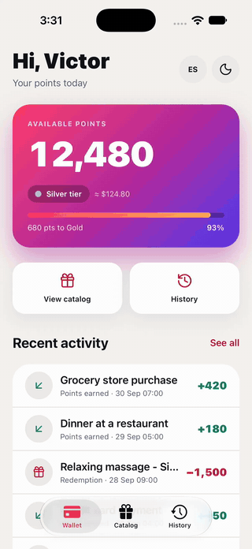
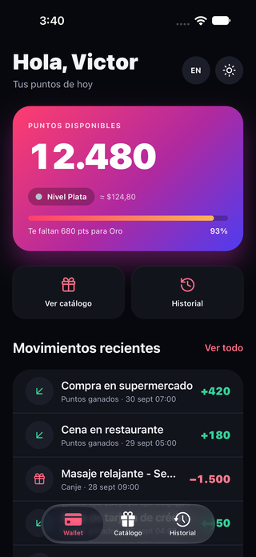
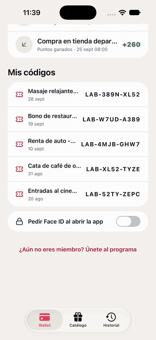

# Angular Native Lab

A public lab of [Angular Native](https://ng-native.com) demos: Angular components
rendered as real native iOS and Android views on Expo, with no WebView. Each demo
uses mock data and documents what worked and **what failed**, with the literal error.

> **Resumen en español:** Laboratorio público de demos de Angular Native (ng-native).
> Cada demo usa datos mock (sin backend ni llaves de API) y documenta con qué versión se
> probó, qué funcionó y qué falló, con el error literal. La app está en inglés y en
> español: sigue el idioma del teléfono y tiene un botón EN/ES. Se clona y se corre en
> el simulador de iOS en unos cinco minutos.

⚠️ Angular Native is in **alpha**. This repo is pinned to exact versions and documents
what breaks; it is not a production guide. Everything below was tested on simulators and emulators, never on a phone; Android coverage is
partial (see [Android](#android)).

<p>
  
  &nbsp;&nbsp;
  
</p>

## Tested with

| | Version |
|---|---|
| `@ng-native/*` | 0.14.0 (also ran on 0.13.0, 0.10.0, 0.9.0, 0.5.0, 0.4.0 and 0.3.0: tags [`ng-native-0.13.0`](https://github.com/victor198siete/angular-native-lab/tree/ng-native-0.13.0), [`ng-native-0.10.0`](https://github.com/victor198siete/angular-native-lab/tree/ng-native-0.10.0), [`ng-native-0.9.0`](https://github.com/victor198siete/angular-native-lab/tree/ng-native-0.9.0), [`ng-native-0.5.0`](https://github.com/victor198siete/angular-native-lab/tree/ng-native-0.5.0), [`ng-native-0.4.0`](https://github.com/victor198siete/angular-native-lab/tree/ng-native-0.4.0) and [`ng-native-0.3.0`](https://github.com/victor198siete/angular-native-lab/tree/ng-native-0.3.0)) |
| Angular | 22.2.1 |
| Expo SDK | 57 (`expo` 57.0.30) |
| React Native | 0.86.3 |
| TypeScript / Vitest | 6.0.3 / 5.0.3 |
| Node | 22.22.3 |
| Device | iOS 27 simulator (iPhone 18 Pro), Xcode 27, Expo Go; Android 16 emulator (Pixel 9), Expo Go and a development build |

## Getting started

Requirements: Node 22 (22.18 or later) and Xcode with an iOS simulator, or Expo Go on
your phone. No development build is needed: everything here runs in Expo Go.

```sh
git clone https://github.com/victor198siete/angular-native-lab.git
cd angular-native-lab
npm install
npm run ios        # opens the iOS simulator with Expo Go
npm start          # or scan the QR code with Expo Go on your phone
```

Checks that run in Node, with no simulator:

```sh
npm test               # Vitest against ng-native's fake native layer (113 tests)
npm run typecheck      # ngc with strict templates
npm run i18n:check     # every translation matches the extracted messages
npm run i18n:extract   # re-extract src/locale/messages.json from a Metro bundle
```

End to end with [Maestro](https://maestro.dev) and Metro running, on the iOS simulator or the
Android emulator (turn the launch lock off first; on Android, run `adb reverse tcp:8081 tcp:8081`
first, and use `APP_ID=host.exp.exponent`):

```sh
maestro test -e APP_ID=host.exp.Exponent -e APP_URL=exp://127.0.0.1:8081 .maestro/join.yaml
maestro test -e APP_ID=host.exp.Exponent -e APP_URL=exp://127.0.0.1:8081 .maestro/login.yaml
maestro test -e APP_ID=host.exp.Exponent -e APP_URL=exp://127.0.0.1:8081 .maestro/device.yaml
maestro test -e APP_ID=host.exp.Exponent -e APP_URL=exp://127.0.0.1:8081 .maestro/lists.yaml
maestro test -e APP_ID=host.exp.Exponent -e APP_URL=exp://127.0.0.1:8081 .maestro/gestures.yaml
maestro test -e APP_ID=host.exp.Exponent -e APP_URL=exp://127.0.0.1:8081 .maestro/whats-new.yaml
```

## Demos

| Demo | What it shows | Status |
|---|---|---|
| [Rewards](#rewards) | Signals + `computed()`, Router with native tabs, Tailwind v4 with `dark:`, a 200-item `<virtual-list>`, Lucide icons | ✅ iOS |
| [i18n (EN/ES)](#i18n-enes) | Angular's own i18n at runtime, device language, an in-app switch, localized numbers, dates and mock data | ✅ iOS |
| [Show at the counter](#show-at-the-counter-inside-rewards) | The voucher as a scannable QR at full brightness, screen kept on and out of screenshots, copy and share. Part of Rewards | ✅ iOS |
| [Join the program](#forms-join-the-program-inside-rewards) | Signal Forms on native inputs and switches, a mock sign-up that rejects a taken email, and what Reactive Forms and `ControlValueAccessor` do. Part of Rewards | ✅ iOS, Android |
| [Device](#device-the-phone-as-signals) | Theme, screen, safe areas, network and live location with the address, each as a signal | ✅ iOS, Android (location needs Google's accuracy setting) |
| [Vault](#vault-inside-rewards) | Face ID / fingerprint for the voucher codes and an opt-in lock on launch, with the preference in the keychain. Part of Rewards | ✅ iOS |
| [Login (JWT + Face ID)](#login-jwt-and-face-id) | Sign in against a mock API, tokens in the keychain, a guard, an interceptor that refreshes an expired token and retries, and Face ID to reopen the session | ✅ iOS, Android (no biometrics) |
| [Lists](#lists-virtual-list-vs-scroll-view) | `<virtual-list>` against `<scroll-view>` at 200 and 2,000 rows, with a live count of the row components actually mounted | ✅ iOS, Android |
| [Gestures](#gestures-drag-pinch-swipe-and-three-ways-to-animate) | Drag that springs back, pinch and rotate, swipe-to-delete rows inside a scrolling list, and the same slide animated by CSS, `Animated`, a worklet and the JavaScript thread, with a button that blocks it | ✅ iOS, Android (pinch and rotate: iOS simulator and Node) |
| [What's new](#whats-new-each-release-note-checked) | One screen per ng-native version, each case a line of the release notes run live, with a badge for what was seen on the iOS simulator and the Android emulator (0.14, 0.13, 0.11, 0.10, 0.9 and 0.8) | ✅ iOS, Android |

### Rewards

A loyalty-program demo: a wallet with an animated balance and tier progress, a catalog
of 200 rewards with category filters, a history grouped by day and a reward detail with
a redeem sheet. It was first built on ng-native 0.1.1 for the LinkedIn post below and
ported here to 0.3.0. Brands and merchants are fictional.

**What was tested:** the four screens on native tabs and a native stack, the
`:id` route param bound as an input, a redemption end to end (sheet, balance, history,
voucher code), the category filter on the virtual list, scrolling, and the dark-mode
toggle, which also restyles the native tab bar.

**What worked**

- The state layer (models, mocks, a `RewardsStore` built on signals and `computed()`)
  moved from 0.1.1 to 0.3.0 **without changing a line**, tests included.
- The UI components and screens also compiled and ran on 0.3.0 as they were.
- Tailwind v4 with `dark:`, `@ng-native/icons` with `@ng-icons/lucide`, and
  `<virtual-list>` behaved the same as on 0.1.1.
- Component tests run in Node with `@ng-native/testing`: no simulator in CI.

**What failed or needed work**

- **The 0.3.0 template no longer ships** `@ng-native/router`, `@ng-native/tailwind` or
  `@ng-native/icons`. They have to be installed (and pinned) by hand, along with
  `react-native-screens` and `react-native-svg` through `npx expo install`. Its
  `src/main.ts` also gained an `import 'expo'` the 0.1.1 one did not have.
- Metro warns at startup. Both warnings are harmless, but they are there:
  ```
  [angular-native] .visible (Tailwind): dropped 'visibility': 'visibility' has no React
  Native equivalent: no style prop of a native view does what it does. Use opacity: 0 to
  hide a box and keep its space, or display: none to remove it.
  [angular-native] .table (Tailwind): dropped 'display': display: table does not exist on
  native; only flex, block (read as flex), contents and none do
  ```
  Tailwind scans every file for class names, so words like "visible" and "table" in the
  source and this README become classes the native side then drops.
- In development, each tab is **blank for 2–3 seconds the first time it opens** while
  Metro bundles that lazy route (2.6 s for the catalog). A release build was not tested.
- My own mistake, not ng-native's: moving a file during the port broke an import,
  `TS2307: Cannot find module '../../core/theme.ts'`. Typecheck caught it.
- Expo Go draws a floating tools button over the top-right corner of the app. It can be
  hidden from its developer menu ("Tools button").

### i18n (EN/ES)

English is the source language; Spanish is a translation. The app picks the language
saved in the app, then the phone's languages in order, then English. It follows
[ng-native's localization guide](https://ng-native.com/guide/localization): Angular's
`i18n` and `$localize`, messages extracted from the Metro bundle with
`localize-extract`, and translations loaded with `loadTranslations()` before the first
frame.

**What was tested:** 79 messages (templates, accessibility labels and computed strings),
the phone in English and in Spanish, the EN/ES button, a cold start after switching,
and numbers, dates and mock data in both languages.

**What worked**

- Runtime translation in Expo Go: one build carries both languages.
- Numbers and dates through Angular's locale data and `LOCALE_ID`: `12,480` /
  `12.480`, `$124.80` / `$124,80`, `30 Sep` / `30 sept`.
- **Switching language with `reloadAppAsync()` works in Expo Go on the iOS simulator.**
  The guide marks it as unverified on a device. The choice is saved with
  `expo-secure-store` and survives closing the app.
- `localize-extract` on an unminified Metro bundle extracted all 79 messages;
  `npm run i18n:check` compares every translation with them.
- The Babel pin the guide asks for held: Babel 8 only appears under
  `@angular/localize` and `@angular/compiler-cli`; React Native stays on 7.29.7.

**What failed or needed work**

- A Vitest test that imports a file which imports `expo-secure-store` or
  `@ng-native/expo/locale` fails before any test runs:
  ```
  RolldownError: Parse failure: Parse failed with 1 error:
  Flow is not supported
  At file: /node_modules/react-native/index.js:1:0
  ```
  Fix: keep native imports out of what components and tests import. Here
  `language.ts` is pure, `localization.ts` holds the native providers, and the switch
  reaches the native side through an injection token (`LANGUAGE_RESTART`).
- Rendering with `LOCALE_ID` set to `es` before registering its locale data:
  ```
  NG0701: Missing locale data for the locale "es".
  ```
  Fix: `registerLocaleData(localeEs)` next to the translations, so whatever loads one
  loads the other.
- A test that created a `providedIn: 'root'` token through `Injector.create()`:
  ```
  NG0201: No provider found for `InjectionToken REWARDS_SOURCE`.
  ```
  That is Angular, not ng-native: a root token needs a root injector. The check moved to
  a component test.
- **ICU plurals and selects, and `i18n-` attributes, tested in the What's new demo (0.9 case A9-1):**
  the extraction works (`npm run i18n:extract` writes `{VAR_PLURAL, plural, =0 {...} one {{INTERPOLATION} ...} other {...}}`,
  `{VAR_SELECT, select, ...}` and the `i18n-accessibilityLabel` text), and the Vitest tests render them
  in English and Spanish. On a device they fail (still so on 0.14.0): in Expo Go in development, on the iOS simulator and
  the Android emulator, mounting one logs `ASSERTION ERROR: The provided value must be an instance of
  a DOM Node but got #anchor` and the sample is left undrawn. This app still uses `$localize` strings.
- `$localize` at module level runs before the translations load and stays in English.
  Tier and category names are translated inside functions for that reason.

### Vault (inside Rewards)

Biometrics in the same app instead of a separate demo, so it maps onto a real product: the
wallet's **My codes** hides the voucher codes of recent redemptions until Face ID passes, and a
switch turns on **Face ID when the app opens**. Built on `Biometrics`
(`@ng-native/expo/biometrics`, over `expo-local-authentication` 57.0.3) and `SecureStorage`
(`@ng-native/expo/secure-store`).

Design choices, kept the way a production app would have them:

- The codes come from the redeem movements (an API in a real app). **Nothing about them is
  stored on the device**; the keychain holds only the lock preference.
- One authentication unlocks the session, for the codes and the app, until it restarts.
- Turning the lock on asks for Face ID first, so it cannot be enabled on a phone that would
  then fail to open it. With no usable sensor, the lock screen offers to turn the lock off (the
  lab has no password to fall back to; a real app would ask the person to sign in again).

**What was tested:** on the iOS simulator with Face ID enrolled, inside **Expo Go**: reading the
sensor kind, revealing the codes, turning the lock on, relaunching into the lock screen, a face
that does not match, cancelling, and unlocking. In Node: the same flows with a fake sensor
(`Biometrics.SOURCE`) and an in-memory keychain (`new Store(native)` from
`@ng-native/expo/store`).

**What worked**

- **Face ID works in Expo Go on the iOS simulator**; no development build was needed. `kinds()`
  reported `face`, the system Face ID sheet appeared, and a matching face resolved
  `{ success: true }`.
- A non-matching face shows iOS's own "Face Not Recognized" dialog; cancelling it resolves
  `user_cancel`, and the app says so in the active language.
- `SecureStorage` reads synchronously, so the route guard sees the stored preference on the very
  first navigation: the app opens straight on the lock screen, with no flash of the wallet.
- Without a fake, in Node, `authenticate()` resolves `{ success: false, error: 'not_available' }`:
  the lock fails closed, as ng-native's docs promise.
- `<switch>` is controlled: when Face ID fails, the app keeps `false` and the switch flips back
  by itself.

**What failed or needed work**

- The first reveal attempt failed with
  ```
  unknown: -1000, Authentication failure.
  ```
  and the second one passed. Our guess is the simulated face was sent too late, after the sheet
  had given up; it was not confirmed. The app shows such errors verbatim inside a generic
  sentence, since they come from the platform.
- Importing `Biometrics` or `SecureStorage` in Vitest works (unlike `expo-secure-store` itself;
  see i18n). Creating them with `Injector.create()` fails with `NG0201: No provider found for
  InjectionToken angular-native.biometricsSource`: they need a root injector, as `render()` has.
- In tests, `userEvent.press()` does not flip a `<switch>`; it listens for the native `change`
  event: `fireEvent(node, 'change', { value: true })`.
- Driving the simulator from scripts: the Face ID sheet waits for
  `xcrun simctl spawn booted notifyutil -p com.apple.BiometricKit_Sim.pearl.match` (or
  `.nomatch`), after enrolling with `com.apple.BiometricKit.enrollmentChanged`. Taps sent from
  outside the Simulator window did not flip a native `UISwitch`; a person had to.

### Login: JWT and Face ID

A sign-in flow of the kind people search for as "Angular login with JWT", here on native views:
email and password with Signal Forms, an access token and a refresh token kept in the keychain,
a guarded account screen, an `HttpInterceptorFn` that refreshes an expired access token and sends
the request again, and **Face ID instead of the password** when the app is opened again. It is a
demo of its own, reached by deep link: `exp://127.0.0.1:8081/--/login` (the app still opens on
Rewards).

> ⚠️ **A mock JWT is not security.** The tokens are base64 JSON with the literal signature
> `mock-signature`: nothing signs or checks them, and there is no server. The "API" is an
> interceptor answering on `https://api.lab.invalid` (`.invalid` can never be a real host). The
> test account lives only in `src/app/demos/login/core/mock-auth/seed.ts`.

How it is put together (`src/app/demos/login/`):

- **`core/mock-auth/`**: the mock server, last in the `HttpClient` chain, so the real client and
  the real auth interceptor run in front of it. `/auth/login`, `/auth/refresh` (it rotates the
  refresh token), `/me` (401 `token_expired` once the access token is old) and `/auth/logout`.
  The access token lives **20 seconds** on purpose, so expiry fits in a video; change
  `accessTtlSeconds` in `mock-auth.config.ts` or provide `MOCK_AUTH_CONFIG`.
  Lab switch, for recording the session dying: `EXPO_PUBLIC_LAB_NO_REFRESH=1 npx expo start --go --clear`
  makes the mock refuse every refresh and write each error it answers into the activity log
  (`GET /me → 401 token_expired`), holding the refusal 3 s so it can be read. Off by default.
- **`core/session.ts`**: the token pair in `SecureStorage`. **The password is never stored**, and
  the form is cleared after a sign-in. A session left in the keychain does not count as signed in
  until the person proves it is them again, with the password or with Face ID.
- **`core/auth.interceptor.ts`**: adds the Bearer token; on 401 `token_expired` refreshes once
  (concurrent requests share the one refresh) and retries once; if the refresh is refused, ends
  the session and goes to the sign-in screen.
- **`core/auth.guard.ts`**: decides on the first navigation, with no loading screen.
- `HttpClient` comes from `provideNativeHttpClient(withInterceptors([authInterceptor,
  mockAuthServer]))` in `src/main.ts`.

**What was tested:** on the iOS simulator (Expo Go, Face ID enrolled): a wrong password, signing
in, waiting out the access token and calling the API, closing Expo Go and opening the demo again
(Face ID is asked for by itself), Lock, a face that does not match, cancelling, and logging out
then relaunching. Maestro (`.maestro/login.yaml`): wrong password, sign in, account, log out, on
the iOS simulator and the Android emulator. On Android also the refresh and a relaunch with a
session left behind. In Node, 25 new tests with a fake sensor (`Biometrics.SOURCE`), an
in-memory keychain (`new Store(native)`) and an injectable clock instead of fake timers.

**What worked**

- **The guard needs no loading screen.** `SecureStorage` reads synchronously, so on a cold launch
  the first navigation already knows whether a session was left in the keychain, and the sign-in
  screen offers Face ID from its first frame.
- **Face ID reopens the session in Expo Go**: a relaunch shows the system sheet by itself, and a
  matching face refreshes the tokens and opens the account. A non-matching face shows iOS's
  "Face Not Recognized"; cancelling it lands on the password form with "Cancelled. Try again when
  you are ready."
- **The refresh is invisible to the screen**: after the 20 seconds, "Call the API" answers as
  before, and the activity log shows "Access token expired, refreshed, request retried". The same
  on Android.
- **Logging out leaves nothing**: an empty form, and after a relaunch no Face ID offer.
- `provideNativeHttpClient()` takes Angular's own `withInterceptors()`, and Angular's
  `HttpInterceptorFn` works unchanged; so does `provideHttpClientTesting()` in Node.
- The demo is in English and Spanish like the rest; the Android emulator showed it in Spanish.

**What failed or needed work**

- **D4, the first Face ID prompt failing with `unknown: -1000`, did not come back on 0.9.0.**
  Six matching faces on the iOS simulator, sent early, late (about 45 s after the sheet appeared),
  right after re-enrolling Face ID and on cold launches: six passes on the first try. The two
  guesses (a face sent too late, the first prompt after enrolling) are ruled out; the 0.5.0
  failure stays unexplained. Trials, steps and a script in
  [`repro/d4-face-id-1000/`](repro/d4-face-id-1000/README.md). No issue drafted: there is nothing
  to reproduce.
- Lock first sent the person back with `Router.navigateByUrl('/login', { replaceUrl: true })`, and
  the sign-in screen did not ask for Face ID: navigating to a URL lower in the native stack goes
  back to the screen already there (as ng-native documents), so no new screen was created and its
  constructor did not run. The test timed out at 3 s. `NativeNavigation.reset()` creates a new
  one.
- One Node test failed once with `expected true to be false`: the keychain still held the tokens
  just after the sign-in heading appeared, when a refused refresh ends the session. The app awaits
  the removal before navigating; the test now polls for it.
- After a sign-in, **iOS itself offers "Save Password?"** for its Passwords app, over the account
  screen. The app never stores the password; this is the system's AutoFill, and the person can say
  Not Now. The dialog lives outside the app, so Maestro cannot find it by its text; a tap by
  position declines it.
- Metro's two Tailwind warnings (`.visible`, `.table`) are still printed, as before this demo.
- After a cold boot the simulator had Face ID **not enrolled**, and the Vault said "Not available
  on this phone." It changed only after enrolling and relaunching Expo Go: `available()` is read
  when the screen is created.
- An Android emulator left running for 7 hours showed only black, even its home screen, and Expo
  Go never asked Metro for a bundle. A cold boot resolved it.

**Not tested:** biometrics on Android (the emulator has no fingerprint enrolled, so the screen
offers only the password, as it should); a real server, real signing or token revocation; a
release build; a phone.

### Device: the phone as signals

One screen, four cards, every value a signal that updates by itself: **theme and screen**
(`ColorScheme`, `Screen`), **safe areas** (`SafeArea`), **network** (`Network`: connected, over
what, internet reachable) and **location** (`Location`: the permission, live tracking, the
position and its street address). A demo of its own, reached by deep link:
`exp://127.0.0.1:8081/--/device`.

How it is put together (`src/app/demos/device/`):

- **`features/device/cards/`**: one component per card, each reading its service straight from
  `@ng-native/device` or `@ng-native/expo`. No wrappers: the signals are the API.
- **`core/location-tracking.ts`**: provided by the location card, so leaving the screen removes
  the native watcher (also when the screen closes while `start()` is still pending). The address
  is looked up on the first position and then only after moving 100 m, because the platform
  geocoders are rate limited; an older answer arriving late is dropped.
- `expo-network` and `expo-location` were added with `npx expo install`; `app.json` carries the
  when-in-use location text and the Android permissions, which only a development build reads.

**What was tested:** on the iOS simulator and the Android emulator (Expo Go): all four cards with
real values, switching to dark mode with the screen open, the location dialog, tracking, and the
position moved by hand (`simctl location set`, `adb emu geo fix`). On Android also the network
going offline and back (`svc wifi`, `svc data`). Maestro (`.maestro/device.yaml`) passes on both.
In Node, 17 tests with fake sources (`ColorScheme.SOURCE`, `Screen.SOURCE`, `Network.SOURCE`,
`Location.SOURCE`).

**What worked**

- **Every value follows the phone with no code to refresh it**: dark mode applied while the screen
  was open; turning wifi and data off showed "No / None / No" and coming back showed "Cellular".
- **Live location on iOS**: after "Allow While Using App", the position and the address arrived
  (Plaza de la Constitución, Mexico City) and moving the simulated location 3.7 km updated both
  (Ángel de la Independencia).
- The permission states read cleanly: not asked, granted, denied (the button stays), and blocked
  (the card sends the person to Settings).
- Safe areas are measured from the first frame: 62 / 34 points on the iPhone 18 Pro, 54 / 24 on
  the Pixel 9.

**What failed or needed work**

- **On Android, tracking threw with nothing on screen.** Asking for `balanced` accuracy makes
  Google Play services show its "Location Accuracy" prompt; declining it rejects
  `watchPositionAsync` with "unsatisfied device settings", and the promise went uncaught. The card
  now says location services are off or limited, and the button tries again. The lab declined the
  prompt (it changes a system setting and shares data with Google), so **no position was seen on
  Android**.
- The intro said "rotate the phone", but `app.json` locks the app to portrait, so the orientation
  never changes. The sentence is gone; rotation is covered by the Node tests.
- Android reports fractional points (411.4 x 923.4); the cards now round to whole points.
- The connection type came out raw (`wifi`, `none`); it is translated now.
- The Maestro flow first waited for the heading, but Expo Go keeps the scroll position between
  runs; it now scrolls up to find it.
- The location dialog took a couple of seconds to appear on iOS, enough to look like the button
  did nothing.

**Not tested:** a real phone; location on Android past Google's prompt; background location (off
on purpose); "Allow Once" expiring; a slow or captive network, where `reachable` should differ
from `connected`.

### Lists: virtual-list vs scroll-view

The same rows, two ways: two toggles pick **200 or 2,000 rows** and **`<virtual-list>` or
`<scroll-view>`**, and a strip shows how many row components are **mounted right now** and how
many were **built** since the last change. Counts only: no timings, in keeping with the rest of
this README. A demo of its own, reached by deep link: `exp://127.0.0.1:8081/--/lists`.

How it is put together (`src/app/demos/lists/`):

- **`core/mount-counter.ts`**: every row component calls it from its constructor and again from
  `DestroyRef.onDestroy`, so "mounted" is exactly the number of Angular row components alive, not
  an estimate from the list's window. Both renderers use the same `ListRow`, 64 points tall.
- The virtual-list is `@for (row of list.window(); track row.slot)` with a fixed `itemHeight`, as
  AGENTS.md says; the scroll-view is a plain `@for` over every row.
- Each change of size or renderer builds a new list from the top, so the built count is that
  list's own. The rows are deterministic mock data, in English and Spanish.

**What was tested:** on the iOS simulator and the Android emulator (Expo Go): both renderers at
both sizes, scrolling, and switching back and forth. Maestro (`.maestro/lists.yaml`) passes on
both, the emulator in Spanish. In Node, 6 tests, including no rows left behind after switching.

**What worked**

| | `<virtual-list>` | `<scroll-view>` |
|---|---|---|
| 200 rows | 12 to 13 mounted | 200 mounted |
| 2,000 rows | 12 to 14 mounted; 14 built after scrolling | 2,000 mounted |

- **The window does not grow with the list**: 2,000 rows mount as many components as 200.
- **Rows are recycled, not rebuilt**: scrolling the virtual-list kept the built count at the
  mounted count.
- **Nothing is left behind**: going from the 2,000-row scroll-view back to the virtual-list
  brought the count down to 12 at once.

**What failed or needed work**

- **The 2,000-row scroll-view blocks the app for seconds** while it mounts every row, on the iOS
  simulator and the Android emulator alike; taps in that time land late. Not measured, and not a
  number to quote: it is the reason AGENTS.md keeps `<scroll-view>` for short content. The
  Maestro flow waits up to 40 s for it.
- The built count first reset on every toggle but the rows were kept across a size change, so it
  read "1 row views built" with 14 mounted. A new list per change made the count honest, and the
  text became "Row views built: N" so it needs no plural.
- The row descriptions stayed in English on the Spanish emulator; they come from translated mocks
  now, as Rewards does.
- The Maestro flow matched only "of" in "12 of 200 mounted" and failed in Spanish ("12 de 200
  montadas").

**Not tested:** a real phone, a release build, rows of varying height (`estimatedItemHeight`),
`endReached` paging, sticky headers.

### Gestures: drag, pinch, swipe, and three ways to animate

Four small demos on one screen, reached by deep link: `exp://127.0.0.1:8081/--/gestures`. The
gestures are `react-native-gesture-handler`'s own (`Gesture.Pan()`, `Pinch()`, `Rotation()`),
attached with `[gesture]`; the values they move are Reanimated shared values, turned into styles
with `[workletStyle]`. The whole app sits inside one `<gesture-root>` in `src/app/app.ts`.

How it is put together (`src/app/demos/gestures/`):

- **Drag** (`drag-card.ts`): a pan writes `translationX/Y` into two shared values; on release
  `withSpring(0)` runs inside the worklet and the card goes back to its place.
- **Pinch and rotate** (`pinch-card.ts`): `Gesture.Simultaneous(Pinch, Rotation)`, scale and angle
  in shared values, each released value saved so the next gesture starts from it. Reset springs
  both back.
- **Swipe to delete** (`swipe-row.ts`, `swipe-rows.ts`): eight fictional rows in the screen's
  vertical `<scroll-view>`. Each row is a pan with `activeOffsetX(-12)`, `failOffsetX(12)` and
  `failOffsetY([-10, 10])`, so only a leftward drag claims it and the scroll keeps working. Past
  110 points the row slides out with `withTiming` and its callback hands the removal to the
  JavaScript side with `scheduleOnRN`; the rows are a signal, and "Restore rows" refills it. The
  row also declares a `delete` accessibility action, since a swipe has no screen-reader form.
- **Four ways to animate** (`animate-compare.ts`): the same slide, set up as CSS `@keyframes`,
  `AnimatedStyle` with `useNativeDriver: true`, a worklet (`withRepeat` on a shared value), and,
  on purpose, `AnimatedStyle` with `useNativeDriver: false`, labelled "JavaScript thread". "Block
  JS for 3 s" is a synchronous busy loop on the JavaScript thread. Each tile says how it is set up
  to run; nothing is timed. The squares start still and run after "Animate" ("Stop" puts them back):
  nothing moves on arrival, and the Maestro flow can read the screen.
- Gesture callbacks never read `this`: shared values go through locals first, as the docs ask.
  The one JavaScript function a worklet needs (`remove`) is passed to `scheduleOnRN`.

**What was tested:** iOS simulator and Android emulator (Expo Go), light and dark. Maestro
(`.maestro/gestures.yaml`) drags the card, scrolls to the rows, swipes the first row left until it
is gone, checks the counter reads 7 of 8, restores, and presses "Block JS" with the squares still
(it centres each button before tapping it: iOS reports a button just under the bottom edge as
visible, and the tap misses). It passed 3 of 3 on the iOS simulator; on the Android emulator, under
load with the simulator and Metro running, 1 of 3, the two failures at the first step, with the demo
on screen and unread by Maestro (the Lists flow failed 1 of 2 the same evening). In Node, 9 tests plus
one in Spanish: pans driven through `gestureOf(...)`, a swipe past the threshold deleting a row and
a short one not, Restore, the empty state, pinch and rotate reaching the style, a second pinch
starting from the first one's scale, Reset, Animate and Stop, and the Block JS button.

With `<gesture-root>` around the whole app, the Login, Join, Device and Lists flows were re-run: all
four pass on the Android emulator, and on the iOS simulator Join and Lists passed the first time.
Login failed once on iOS at the wrong-password assertion and passed on an immediate rerun (not
reproduced, cause not found); Device failed until the simulator's location was set again
(`xcrun simctl location booted set 19.4270,-99.1677`, the same loss noted under 0.9.0), then passed.

**What the JavaScript block showed** (iOS simulator, screenshots every ~0.4 s while the 3 s loop
ran, dot positions compared between frames; the Android emulator, screenshots about every second,
agreed): the CSS, native-driver and worklet squares kept moving; the "JavaScript thread" square
stayed where it was for the whole block and resumed afterwards. The status line reads "Blocking the
JavaScript thread..." while it runs. No timings were taken.

**What failed or needed work**

- **My first native-driver tile froze too.** It was `Animated.loop(Animated.sequence([to 1, to
  0]))` with `useNativeDriver: true`, and during the block it stopped alongside the JavaScript
  square. A loop of a sequence is restarted from JavaScript at each leg, so a busy JavaScript
  thread stops it once the current leg ends. The tile is now one `Animated.timing` in a loop, with
  the back-and-forth made by the interpolation (`[0, 0.5, 1]` to `[0, 84, 0]`), and it kept moving.
  Only the second version should be read as "native-driven".
- **`@ng-native/components/animations` has no Vitest stand-in.** The setup page lists stand-ins
  for gestures, Reanimated and worklets only, and a test that renders a component importing
  `AnimatedStyle` fails to load with `AggregateError: oxc transform error  Plugin: vite:define
  File: .../node_modules/react-native/Libraries/Animated/nodes/AnimatedProps.js`. The tests use
  `vi.mock('@ng-native/components/animations', () => import('./animations-fake.ts'))`, a small fake
  of `Animated`, `Easing` and the directive, so the animation itself is not exercised in Node.
- **A free pan on a card takes vertical drags that start on it**, so a swipe meant to scroll the
  page moved the card instead. The drag card now starts only on a sideways move
  (`activeOffsetX([-10, 10])`, `failOffsetY([-10, 10])`) and follows the finger both ways once
  started; a vertical swipe that begins on it scrolls the page (checked on the iOS simulator). The
  rows use the same `failOffsetY`.
- **After a hot template swap the pans stopped responding on iOS** (the drag and the row swipe did
  nothing, no events reached JavaScript until the app was reloaded). I saw it once while editing the
  screen and did not isolate the cause; a fresh launch worked every time. Restart the app after
  editing a gesture screen.
- **Maestro's `tapOn` on iOS returns after the block ends** (it waits for the app to be idle), so
  it cannot time a screenshot inside the block. The frames were taken in a loop around the tap.
- The "Blocking..." text never showed with a 150 ms wait before the loop; the commit had not
  reached native. It shows with 400 ms.
- Android's `uiautomator dump` fails while the squares animate ("could not get idle state"). With
  the squares running from arrival, the flow passed 0 of 3 on Android and 1 of 3 on iOS; that is why
  they now wait for "Animate".
- Pinch and rotate cannot be driven from Maestro. They are covered in Node, and on the iOS
  simulator with a two-finger touch path: the card scaled to about 2x and turned, and Reset brought
  it back. Not tried on Android or with real fingers on a phone.

**Not tested:** a real phone, two-finger pinch or rotate on a device, a swipe inside a horizontal
pager (`Gesture.Native()` plus `blocksExternalGesture`), animation under load beyond the 3 s block.

### What's new: each release note, checked

A demo that takes the lines of the ng-native release notes and runs them, so the notes can be
confirmed or contradicted on a device. Reached by deep link: `exp://127.0.0.1:8081/--/whats-new`
(a list of versions), and `exp://127.0.0.1:8081/--/whats-new/0.14`, `.../0.13`, `.../0.11`, `.../0.10`, `.../0.9` or `.../0.8` for one version's cases. Spanish:
"Novedades".

How it grows, one version at a time (`src/app/demos/whats-new/`):

- A **release** is data: `core/releases.ts` lists them, newest first, and each has a
  `cases-*.ts` file (`core/cases-0-10.ts`) with the case id, the PR numbers from the note, the title,
  a one-line "the note says", and a **status**. A case's live demo is a small component in
  `features/cases/`, picked by id in `features/version/version.screen.ts`.
- Adding a release (0.9 was added this way) means: a `cases-*.ts`, a row in `releases.ts`, the demo
  components, and their `@case` lines in the version screen. The list screen and the route
  (`whats-new/:version`, bound as an input) do not change.
- Every card has test ids built from the case id (`whats-new-a10-1`, `-title`, `-prs`, `-status`),
  so a case can be reached by `scrollUntilVisible` or a test.
- The status is **set by hand from a run** and never from the note: `verified` (with the platforms),
  `caveat`, `not-as-described` (each with a note) or `not-checked`. A case with no run stays
  `not-checked`.

**What was tested** (iOS simulator, iPhone 18 Pro iOS 27.0, and the Android emulator, Expo Go,
light scheme, English): each case below on both. Screenshots were taken from Maestro's
`takeScreenshot` and `simctl` / `screencap` and kept outside the repo.

| Case | PR | iOS | Android | What was seen |
|---|---|---|---|---|
| `Dialogs.choose()` on Cancel | #729 | ✅ | ✅ (Cancel only) | iOS: Cancel gives `null`, Save gives `0`, a tap outside the sheet gives `null`. Android: Cancel gives `null`, Save `0`; a tap outside and the system Back key did not dismiss the dialog, so there is no dismissal to test there |
| Deep link pushed over the screen | #715, #733 | ✅ | ✅ | With `whats-new/0.10` showing, `simctl openurl .../--/device` (Android: `am start -a VIEW -d`) opened Device over it; the iOS back button read "Version 0.10" and returned to the same scroll position |
| `::ng-deep` after a selector | #754 | ✅ | ✅ | The text under `:host ::ng-deep .inner` is crimson; the one under a bare `::ng-deep .inner` stays gray |
| `dark` class on the root view | #707 | ✅ | ✅ | The box that has the class itself goes near black with `dark:bg-zinc-950` and white again when toggled off |
| Border with no color | #752 | ✅ | ✅ | The 3 pt border is crimson (the text color), and black where `border-color: black` is written |
| One long word | #753 | ✅ | ✅ | "Supercalifragilistic" is one line cut at the 90 pt box edge, no ellipsis; "Three short words" is three lines |
| z-index across plain views | #726 | ✅ | ✅ | A box with `z-index: 3` inside a plain view is above two later siblings with 2 and 1 |

The Maestro flow (`.maestro/whats-new.yaml`) opens the list, opens 0.10, drives the dialog (Cancel
reads `null`, Save reads `0`), toggles the dark class, and sends the `/--/device` link while the app
runs and returns. It passed 3 of 3 on the iOS simulator and 3 of 3 on the Android emulator. The four
style cases are visual: their screenshots are the evidence. In Node, 7 tests plus one in Spanish:
the version list and its navigation, the seven cards with their PR numbers and badges, a stand-in
`Dialogs.SOURCE` (`Dialogs.SOURCE` is the token the class gives for exactly this) answering the
sheet with an index and with the cancel index, and the dark toggle.

**0.9 cases** (same devices, Spanish on the emulator). `tw-animate-css` 1.4.0 is a dependency, imported in
`src/styles.css` for A9-5. Animations start from a button and are finite, so Android's uiautomator can
read the screen. The panel case reads each panel's height from `(layout)`.

| Case | PR | iOS | Android | What was seen |
|---|---|---|---|---|
| ICU plurals, selects, `i18n-` attributes | #687 | ❌ | ❌ | **Not as described.** `npm run i18n:extract` extracts them correctly (`{VAR_PLURAL, plural, =0 {No rewards} one {{INTERPOLATION} reward} other {{INTERPOLATION} rewards}}`, `{VAR_SELECT, select, gold {...} silver {...} other {...}}`, and the `i18n-accessibilityLabel` text), and Vitest renders them in EN and ES (0, 1 and 5; the label). On a device, in Expo Go in development, mounting the sample logs `ASSERTION ERROR: The provided value must be an instance of a DOM Node but got #anchor` (twice per mount) and nothing of it is drawn but empty buttons. Angular's own `assertDomNode(anchorRNode)`, which runs only when `ngDevMode` is on. A production-mode bundle (`expo start --no-dev`) does not load in Expo Go here (`Unable to determine the production URL ... "location" is not defined`), so a release build is untested. The sample mounts on a press so the other cases stay on screen |
| Same-named `@keyframes` | #694 | ✅ | ✅ | Two components with `@keyframes pulse`: the blue square scales to 1.6, the green one slides 80 pt, each its own |
| `var()` and `em` in keyframes | #696, #697 | ✅ | ✅ | Panels with `--panel-height` 40px, 96px and `4em` open to 40 / 96 / 64 pt, read from `(layout)` (iOS mid-frames: 5/11/7, 13/30/20, 26/63/42) |
| Press on a view faded to `opacity: 0` | #690 | ✅ | ✅ (also counts) | After the fade ends the counter still goes to 1 on a tap of the invisible button. The badge claims iOS only, as the note does |
| `tw-animate-css` `animate-in` | #700 | ⚠️ | ⚠️ | `fade-in-0 zoom-in-95` fades and shrinks in (pale and narrower, then full) on the 1.5 s card; the 200 ms card is too fast to catch mid-frame. The Tailwind build prints `@keyframes enter (Tailwind): dropped 'filter': filter: blur() is not drawn on iOS` |

The Maestro flow also drives the 0.9 cases (it does not assert A9-1, which does not render on a device):
the two squares, the panel readout, the invisible button and the cards. It passed 3 of 3 on the iOS
simulator and 3 of 5 on the Android emulator: the two failures were the first step, the 40 s wait for
Expo Go to load after a cold start, before any case ran. In Node, 4 more tests (`whats-new-0-9.test.ts`,
and one in Spanish): the 0.9 cards and badges, the plural at 0, 1 and 5, the select, the label, the
press counter, and the cards of A9-5.

**0.8 cases** (same devices; Android in Spanish). No new dependency. A8-1 reads the same
`Location.permission` as the Device card (`@ng-native/expo/location`), without touching that demo.

| Case | PR | iOS | Android | What was seen |
|---|---|---|---|---|
| `Permission.ensure()` after Settings | #682 | ✅ | ✅ | **iOS:** `simctl privacy revoke location host.exp.Exponent` did not kill the app; after a "Read the permission" press the card read `denied` / `blocked(): yes`, and "Ask with ensure()" answered `not granted` with no dialog. Then `simctl launch com.apple.Preferences` (the Settings app in front), `simctl privacy grant location host.exp.Exponent`, and `simctl launch host.exp.Exponent` to come back: with no press the card read `granted` / `blocked(): no` (same process id 35171 throughout), and `ensure()` answered `granted` with no dialog. A second run granted while the app stayed in front and pressed Ask: `ensure(): granted`, no dialog. `simctl openurl app-settings:` fails on this simulator (`LSApplicationWorkspaceErrorDomain error 115`), and the Settings toggle itself was not driven: the grant is `simctl privacy`. **Android:** `pm revoke` kills the app (process gone), so it was relaunched; "Ask with ensure()" showed the system dialog, "Don't allow" gave `denied` / `blocked(): yes`, and a second ask showed no dialog (`not granted`). Then `am start -a android.settings.APPLICATION_DETAILS_SETTINGS` (Settings in front), `pm grant` of both location permissions, and Back to the app: `granted` / `blocked(): no` by itself, same process id 32169, and `ensure()` then answered `granted` with no dialog. The Google "Location Accuracy" prompt never appeared (nothing starts tracking) |
| Transitions through Block JS | #672, #676 | ❌ | ❌ | **Not as described, and not for the reason first thought.** The opacity and transform tile moves through the 3 s block on both platforms. The width and height tile stopped for the block and jumped after it because the Animate button changes length (Animate to Reset) in that commit, which is the documented fallback to JavaScript. Isolated with one box per screen (`/--/repro/size-transition?v=wh`, screenshots timed against the press, 8 s linear, block 100 ms after): a lone `width`, `height` or both is **not animated at all**, it snaps to its end value within 0.5 s of the press, with or without the block, on iOS and Android, while `transitionstart` and `transitionend` still fire 8 s apart. Adding a button label that changes length, or a second box resized with no transition, makes it animate from JavaScript and freeze for the block. See `docs/findings/size-transition-block-js.md` |
| Padding, margin, radius transitions | #670 | ✅ | ✅ | 2 s linear, nothing written at 0: padding read 0, 4, 7, 10, 14, 17, 20 at 0.33 s steps on iOS (margin the same), the green box's radius rounded in step; Android showed the red border and the radius growing over the same frames |
| Gradient in a custom property | #664 | ✅ | ✅ | `[style.--x]` holding `linear-gradient(90deg, red 0%, gold N%, blue 100%)`: `background: var(--x)` draws it and the gold stop follows the buttons (50 %, 10 %, 90 %); `background-color: var(--x)` with the same value draws nothing, as the note says |
| Icon `size` in px and rem | #668 | ✅ | ✅ | `18px`, `1.5rem`, `24` and an unreadable `big` read 18 / 24 / 24 / 16 points from `(layout)`; the last one is the text size (16 with no font size in scope) and looks smaller than the other three |
| `not-dark:` in dark mode | #675 | ✅ | ✅ | The swatch is amber (`not-dark:bg-amber-200`) in light and zinc (`dark:bg-zinc-800`) in dark, with `simctl ui appearance dark` and `adb shell cmd uimode night yes`; both left on light. The `md:max-lg:` half of the note needs a width change and was not tried |

The Maestro flow also drives the 0.8 cases: it reads the permission, runs Open on the padding box,
moves the gradient stop, and reads the icon sizes and the scheme (A8-2 is judged from a recording,
A8-1's Settings round trip needs `simctl` or `adb`). It passed 3 of 3 on the iOS simulator and 3 of 3
on the Android emulator. In Node, 7 more tests (`whats-new-0-8.test.ts`): the six cards and badges,
A8-1 with a fake location whose answer changes (a foreground event through `Permission.FOREGROUND`,
and `ensure()` seeing the change with no foreground event), the transition tiles, the gradient
buttons, the four icon sizes read from the drawn props (18 / 24 / 24 / 16) and the scheme toggle.
`whats-new.test.ts` still asserts the versions `['0.10', '0.9']` and is red until it is updated.

**0.13 and 0.11 cases** (same devices; Android in Spanish). No new dependency: `react-native-svg` was already
there, and the `<mask>`, `<clipPath>` and `<use>` drawings are markup written by hand and passed through
`[svg]`, the path an `@ng-icons/*` string takes, so no icon set was installed. **0.12.0 has no section:**
all three of its entries are DOM components (they need `@ng-native/web` and `@angular/platform-browser`,
which this lab does not have) or `registerViewName`, so they stay in `docs/whats-new-triage.md` as LIST and SKIP.
The three tab cases (#761, #774, #783) run in a small **tabs lab** of their own, a tab bar under
`whats-new/tabs/:org` (Home, Search behind a 4 s guard, Library with a stack, a guarded page presented
over Home), pushed from the case card; the Rewards tabs are not touched.

| Case | PR | iOS | Android | What was seen |
|---|---|---|---|---|
| `DeepLinks.openSettings()` | #776 | ⚠️ | ✅ | **Caveat.** Android: the button opens Expo Go's *App info* page (Notifications, Permissions, Storage...). iOS simulator: it opens the Settings app at its top-level list (Apple Account, General, Accessibility...), not a page of Expo Go; no error, and `simctl launch host.exp.Exponent` returned to the same screen. The earlier `simctl openurl app-settings:` error 115 did not show up through the button. Node: a fake `DeepLinkSource` gets one `openSettings()` per press, and a source without one opens nothing |
| Back to the front tab while another loads | #761 | ✅ | ✅ | Search tapped, then Home about a second later (Maestro): 7 s later Home is still the tab in front and its url reads `/whats-new/tabs/1/home`. Control: Search alone opens after the 4 s guard. The "before" was not seen |
| Tab bar under `org/:org` with `reuseScreen` | #774 | ⚠️ | ⚠️ | **Caveat.** Library, Open album x (`/1/library/x`), Home, Go to org 2, Library: the url is `/whats-new/tabs/2/library`, org 2's first page, not `/1/library/x`. But the Library tab then drew org 1's Album x page and the Library page together, one above the other (see `ios-a11-3-library-org2.png`), and stayed so after 1 s and after a later capture. Not investigated: it may come from how the lab nests a stack under a reused screen |
| `NgIcon` mask, clipPath, use | #785 | ✅ | ✅ | A square with a round hole, a circle with a stripe that stays inside the circle, two stars. Node: the committed tree has `RNSVGMask`, `RNSVGClipPath` and two `RNSVGUse` |
| Colour from `var(--accent)` | #785 | ✅ | ✅ | The pin is `#be123c`, then `#0369a1` and `#15803d` as the button moves `--accent` on the view around it |
| `provideNgIconsConfig` | #785 | ✅ | ✅ | The bare icon is 28 points, blue, thick line; the one with `size` 44 keeps 44 (`Drawn: 28 / 44 points`, from `(layout)`) |
| `provideNgIconLoader` + `withCaching()` | #785 | ✅ | ✅ | Two pins (a string) and a ring (a promise, 200 ms) are drawn; `Loader asked 2 times: loaded-pin, loaded-ring`. Clear and Draw again: still 2 |
| Static `aria-label` | #785 | ✅ | ✅ | Maestro finds "Pin on the map" on both platforms (the accessibility tree); Node: the labelled icon is `accessible`, role `image` |
| `--ng-icon__size` | #785 | ✅ | ✅ | `Drawn: 32 / 16 points`: 32 inside a view that sets `--ng-icon__size: 32px`, 16 with nothing around it |
| `stroke-dasharray="none"`, `opacity="50%"` | #785 | ✅ | ✅ | The `none` lines are solid under a dashed one; the 50% bar is the same pale tone as the 0.5 bar |
| `preventNativeDismiss`, page from another tab | #783 | n/a | ✅ | Android: Present a Library page from Home (url `/whats-new/tabs/2/home(presented:whats-new/tabs/2/library/guarded)`), system Back: the sheet stays and `Back refused: 1`. iOS has no Back button: the sheet opens and Close leaves; the badge says Android only |

The Maestro flow now ends with the 0.13 and 0.11 cases (readouts, the loader, the aria-label, Back refused on
Android, the Search guard, the org switch). It passed 3 of 3 on the iOS simulator and 3 of 3 on the Android
emulator; an earlier Android start failed at the first step (Expo Go still loading after a cold start,
before any case ran), so the runs were made with the app already open on the list. A11-1 leaves the app and
the drawings (A13-1, A13-7) are screenshots, not asserted. In Node, 15 more tests
(`whats-new-0-11-0-13.test.ts` and `whats-new-0-13.es.test.ts`): the cards and badges of both versions,
`openSettings` through a fake `DeepLinkSource` (with and without the method), the lab and its org switch,
and each icon case read from the committed props (mask, clip path and use, colour from the token, config,
loader and cache, aria-label, `--ng-icon__size`, dash and opacity), plus the Spanish render.

**The Q1 probe: is `@expo/ui` in Expo Go for SDK 57?** On a scratch branch, `npx expo install
@expo/ui` added `@expo/ui ~57.0.22`; `registerExpoUiViews(Platform.OS)` in `main.ts` and a throwaway
screen with `<ui-host><ui-text>Hello from SwiftUI</ui-text></ui-host>` and `<ui-host><ui-progress
[value]="0.4" /></ui-host>`. On the iOS simulator in Expo Go (no new build) both rendered: the text,
and a SwiftUI progress bar at 40 %. No error text. Not tried on the Android emulator (it was no
longer running at the time) and not a Live Activity. The branch and the install were reverted
(`package.json`, `package-lock.json` and `node_modules` as before), and the #757 case is not built
yet. So the `@expo/ui` cases of the triage (B6-3, B7-1, B10-5) need no development build on iOS.

**0.14 cases** (same devices; Android in Spanish). `docs/whats-new-triage.md` has the 64-row triage of the
0.14.0 notes: 28 PICK rows (13 in these 12 cases, 15 reserve), 9 TEST-ONLY, 9 LIST, 18 SKIP. The cards read
what each case measured from `(layout)`; the fade is judged from a host-clock screenshot loop.

| Case | PR | iOS | Android | What was seen |
|---|---|---|---|---|
| Bound size in `em`, `rem`, `vw`; `<ng-icon size="2em">` | #786, #784 | ✅ | ✅ | At font size 16: `2em` 32, `2rem` 32, `50vw` 201 (iOS, 402 pt wide) and 206 (Android), icon 32. After the button (24): 48, 32, same, 48. A Vitest test asserts the committed numbers (the PR's own test fails on 0.13.0 with the text `'2em'` committed) |
| A class brings in the transition and the value | #846 | ⚠️ | ⚠️ | **Caveat.** Opacity and transform ease over the 6 s on both platforms, with no transition before and with `transition: none` before (x 108 to 768 px and opacity to 0.2 in about 0.5 s steps on iOS). **Width does not: the bar is at its end width (280 pt) in the first capture after the press, in both lanes, on both.** Same as the size-transition repro (below) |
| Border colour before its width | #819 | n/a | ✅ | Both boxes get a seagreen border, not black, on Android (iOS the same). The second box asks for `border-style: dashed` and Android drew it solid, iOS dashed: not what #819 is about, not investigated |
| `aspect-ratio` across a flex line | #842 | ✅ | ✅ | In a 200 pt column the view is 200 x 100 |
| A minimum over a maximum | #840 | ✅ | ✅ | `min-height: 80` over `max-height: 40` measures 80, `min-width: 160` over `max-width: 100` 160, padding 16 and border 2 over `max-height: 20` 36 |
| Wrapped lines stretch | #841 | ✅ | ✅ | In a 160 pt wrapping row with four height-less items, each is 80 tall (two lines) |
| Truncated text written into a view | #843 | ✅ | ✅ | `truncate` is one line with an ellipsis (19 pt iOS, 22 Android), `line-clamp-2` two (38, 40), a plain view all of it (57, 59) |
| A flex-col label of spans | #844 | ✅ | ✅ | `<label class="flex flex-col">` (Tailwind) and the same written as a rule in a sheet stack Name over Hint (39 / 39 pt iOS, 43 / 43 Android); a plain label is one line (19, 22). In Node only the sheet rule is committed as a view: the Vitest run does not load Tailwind |
| `aria-checked="false"` | #803 | ✅ | ✅ | Android uiautomator: the checkbox is `checked: false`, the `"true"` one `checked: true`. iOS hierarchy value: `checkbox, unchecked` / `checkbox, checked` |
| CSS system colours | #820 | n/a | ✅ | `CanvasText`, `FieldText`, `ButtonText` and `GrayText` all draw on Android, in the text colour (GrayText not grey, as the note says); iOS draws GrayText grey |
| Number inputs bound to `undefined` | #803 | ✅ | ✅ | `[delayLongPress]` unset: a held press hears the long press after 500 ms on both; a `virtual-list` with `[rowGap]` and `[overscan]` unset draws its 3 rows |
| CSS in a `style` attribute | #803 | ✅ | ✅ | `style="padding: 4px 8px"`: the inner view is at x 8, y 4; `line-height: 1.5` on a 20 pt text is a 30 pt line |

The 0.14 section of the Maestro flow reads those numbers and passed 3 of 3 on the iOS simulator and 3 of 3 on the Android emulator (whole flow). The Node tests
(`whats-new-0-14.test.ts`, 9) assert what the engine commits for A14-1, 5, 6, 8, 9, 10, 11 and 12 and the
cards with their badges; A14-2, 3, 4 and 7 need a device (no layout, no clock). The dev-build entries
(`<search-field>`, bottom-sheet toolbars, `ui-picker` on Android) are LIST in the triage.

**Caveats**

- #729 is an iOS change. Android was run too, but on Android the choice dialog cannot be dismissed
  by tapping outside or with Back, so the note's "or the sheet is dismissed" has nothing to show
  there; its badge says iOS only.
- The visual cases were looked at after the fact, not compared with 0.9: "before" is what the notes
  say, not something this lab saw.
- The `NgDeepBare` component keeps the bare `::ng-deep` rule on purpose, so Metro and Vitest print
  "dropped a rule: '::ng-deep' with nothing before it..." on every build. That warning is the
  note's "still dropped".
- A text's `(textLayout)` event, which I tried for a "lines drawn" readout on the one-word case,
  stayed at 0 lines on iOS with a line-count handler on `<text>`; it is not documented, so the case
  has no readout and relies on the screenshot. Not investigated further.
- A link to the screen already showing does nothing (Expo Go does not push the same url again), so
  the Maestro flow needs Expo Go closed at the start.
- Dark scheme of the device was not tried for the `dark` class case, only the class toggle in light.

### Show at the counter (inside Rewards)

A redemption's code, ready for the partner to scan: **Show at the counter** on the success
screen, or a code in **My codes**, opens the voucher as a QR. While it is open, the app raises
its own brightness to full, keeps the screen on and keeps it out of screenshots; all three are
put back when it closes. Copy and Share sit underneath, and a redemption ends with a success or
error haptic.

The QR needs no QR library for React Native: `qrcode-generator` (MIT, no dependencies) makes the
matrix, each row's run of dark cells becomes one rectangle in a single `<path>`, and
`<ng-icon [svg]>` from `@ng-native/icons` draws that markup as native react-native-svg shapes.

**What was tested:** on the iOS simulator in Expo Go: the QR on screen, decoding it, Copy, Share,
and the two ways in. In Node: every module faked through its `SOURCE` token, checking what the app
asks the phone to do and that it is all undone on close.

**What worked**

- **The QR scans.** A simulator screenshot decoded with macOS's own Vision framework read
  `LAB-52TY-ZEPC`, the code printed under it. A version-1 code is one `RNSVGPath`.
- **Copy:** the simulator's pasteboard (`xcrun simctl pbpaste booted`) held the code, and the
  button said "Copied".
- **Share:** the system share sheet opened with the message in the active language.
- All of it in Expo Go: `expo-brightness`, `expo-keep-awake`, `expo-screen-capture`,
  `expo-haptics` and `expo-clipboard` needed no development build.
- In Node, closing the screen calls `restore()`, releases the `voucher` keep-awake tag and
  allows capture again for the `voucher` key.

**What could not be checked here, so is not claimed**

- **Brightness and haptics** have nothing to see or feel on a simulator; the tests only show the
  calls.
- **Screenshot prevention:** `xcrun simctl io booted screenshot` captured the voucher anyway. It
  grabs the frame from outside iOS, so it says nothing about what the user's own screenshot
  would do; that needs a phone. The "a screenshot was taken" warning is tested in Node only.
- **Keep awake:** not observable in a short session.

### Forms: Join the program (inside Rewards)



A member sign-up, reached from the wallet ("Not a member yet? Join the program"): name, email,
an optional phone, a promotions switch and a terms switch. It uses
[Signal Forms](https://angular.dev/guide/forms/signals/overview) bound straight to the native
controls, as [ng-native's forms guide](https://ng-native.com/guide/forms) describes:
`<text-input>` takes `value` and `<switch>` takes `checked`, both models, with no adapter class.
The sign-up is a mock that takes about a second and answers that `taken@example.com` is already
registered.

**What was tested:** on the iOS simulator and the Android 16 emulator in Expo Go, driven by
the same Maestro flow ([`.maestro/join.yaml`](.maestro/join.yaml), recorded in the GIF on iOS):
an empty submit, the taken email, fixing it and joining. In Node: validation, the red border, the server error, success and
the way in from the wallet, plus [a test](src/app/demos/rewards/features/join/forms-compatibility.test.ts)
of every other Angular form pattern on a `<text-input>`.

**What worked**

- **Signal Forms is stable in Angular 22.** Everything used here (`form`, `FormField`,
  `required`, `minLength`, `email`, `pattern`, `validate`, `submit`) is `@publicApi 22.0` in
  `@angular/forms/signals`; only `provideExperimentalWebMcpForms` is still experimental.
  `@angular/forms` has to be pinned to the exact `@angular/core` version (22.2.1).
- `[formField]` on `<text-input>` and `<switch>` binds both ways with nothing else.
- `submit()` marks every field touched, calls `onInvalid` (a warning haptic here) when something
  is wrong, and only runs `action` on a valid form. While it runs, `submitting()` disables the
  button and changes its label. The "already registered" answer comes back from `action` with
  `fieldTree: f.email` and shows under the email like any validation error.
- The invalid look is plain CSS in the component, compiled at build time:
  `.field[data-invalid][data-touched] { border-color: ... }`, with a dark-mode colour.
- Email and phone keyboards, autofill hints and accessibility labels are ordinary props.
- Labels and messages come from the same i18n as the rest of the app.
- 0.4.0's HTML elements, which need no import, draw the layout and copy: `section`, `h1`, `p`,
  `label`, `div`.
- **Reactive Forms and `ngModel` work too, and so does a control of your own with
  `ControlValueAccessor`**, on iOS, on Android and in Node. The guide is right that ng-native's
  components do not implement `ControlValueAccessor`; they do not need to. In `@angular/forms`
  22.2.1, when an element has no value accessor but has a `value` model, `[formControl]` and
  `ngModel` bind to that model directly, so they work on `<text-input>` as they are. Checked on a
  temporary screen with Maestro, on both platforms:

  | Pattern | Result |
  |---|---|
  | `[formControl]` on `<text-input>` | Typing reaches the `FormControl`, `setValue()` reaches the field, leaving it marks it touched, `disable()` stops typing |
  | `[(ngModel)]` on `<text-input>` | Both ways (Node) |
  | A custom control with `ControlValueAccessor`, bound with `[formControl]` | Both ways |
  | The same control bound with Signal Forms `[formField]` | Both ways |

  The custom control keeps its value in a signal: the app is zoneless, so a plain field set from
  `writeValue()` would not redraw. Not tried on a phone.

**What failed or needed work**

- **`pattern()` lets an empty value through.** A 10-digit phone pattern does not make the phone
  required, so the field is labelled optional; adding `required()` would be the fix if it were not.
- **Forgetting `FormField` in `imports`** binds nothing: the field stays empty and typing never
  reaches the form. The guide says this compiles and logs in development. The log is there:
  ```
  [angular-native] Can't bind to 'formField' on <text-input>: no directive in its template
  takes it, so it binds nothing. Add FormField from '@angular/forms/signals' to the
  component's `imports`.
  ```
  But `npm run typecheck` (ngc with strict templates) does not compile it, so it is caught
  before running:
  ```
  NG8002: Can't bind to 'formField' since it isn't a known property of 'text-input'.
  ```
  Metro's build does not type-check, so the app still builds and runs with the mistake.
- **`data-invalid` and `data-touched` are not native props.** They exist only for the CSS
  selector, so a test cannot read them from the rendered view; the tests check the border colour
  instead.
- **HTML elements are views, not the web.** A `div` lays its children out in a column, as every
  native view does. Angular drops text nodes that are only whitespace, so a space between two
  pieces of text disappears; `&nbsp;` keeps it.
- **On the Android emulator, the keyboard and Maestro got in the way, not the app.** Gboard
  stopped once with `Fatal signal 4 (SIGILL)` in its spell checker and then opened its stylus
  tutorial over the form. Maestro's `hideKeyboard` presses back when no keyboard is up, which
  leaves Expo Go, so the flow closes the keyboard by tapping the intro text instead. Expo Go also
  keeps a screen's state when sent to the background: a rerun typed into fields that still held
  the last run's text. Start each run from a closed Expo Go.
- Simulators and emulators only. The keyboard covering the submit button was not looked at.

## Module coverage

Every native module this lab uses, where it was tested and what it needed. ✅ worked, ⚠️ worked
with a caveat, — not tested there.

| Module | Package | Used for | iOS sim, Expo Go | Dev build needed | Tested on device | Notes |
|---|---|---|---|---|---|---|
| `Locale` | `@ng-native/expo/locale` (`expo-localization`) | Device language for i18n | ✅ | No | — | |
| `SecureStorage` | `@ng-native/expo/secure-store` | Language choice, lock preference, login tokens | ✅ | No | — | Reads synchronously, so guards see it on launch |
| `Biometrics` | `@ng-native/expo/biometrics` (`expo-local-authentication`) | Vault, Login | ✅ | No | — | `unknown: -1000` seen once on 0.5.0, not on 0.9.0 ([repro](repro/d4-face-id-1000/README.md)); Face ID usage string needed for dev builds |
| `Brightness` | `@ng-native/expo/brightness` | Voucher | — | No | — | Calls verified in Node; nothing to see on a simulator |
| `KeepAwake` | `@ng-native/expo/keep-awake` | Voucher | — | No | — | Calls verified in Node |
| `ScreenCapture` | `@ng-native/expo/screen-capture` | Voucher | ⚠️ | No | — | `simctl` screenshots are not blocked (taken from outside iOS) |
| `Haptics` | `@ng-native/expo/haptics` | Redeem, copy, join | — | No | — | No haptics on a simulator |
| `Clipboard` | `@ng-native/expo/clipboard` | Copy the code | ✅ | No | — | |
| `Sharing` | `@ng-native/device` | Share the code | ✅ | No | — | `true` means a target was chosen, not delivered |
| `NgIcon` with `[svg]` | `@ng-native/icons` (`react-native-svg`) | Lucide icons, the QR | ✅ | No | — | Parser handles `svg`, `g`, `path`, `rect`… |
| `ColorScheme` | `@ng-native/device` | Dark mode, Device | ✅ | No | — | Also ✅ on the Android emulator |
| `Screen`, `SafeArea` | `@ng-native/device` | Device | ✅ | No | — | Android reports fractional points. Also ✅ on the Android emulator |
| `Network` | `@ng-native/expo/network` (`expo-network`) | Device | ✅ | No | — | Offline and back verified on the Android emulator; the iOS simulator follows the Mac's network |
| `Location` | `@ng-native/expo/location` (`expo-location`) | Device: tracking, reverse geocoding | ✅ | No | — | Android: declining Google's Location Accuracy prompt rejects the watcher. Usage text needed for dev builds |
| Router, native tabs and stack | `@ng-native/router` | All navigation | ✅ | No | — | |
| `<virtual-list>`, `<scroll-view>` | `@ng-native/components` | Rewards catalog and history, Lists | ✅ | No | — | 2,000 rows: 12–14 components mounted vs 2,000. Also ✅ on the Android emulator |
| Signal Forms on `<text-input>` and `<switch>` | `@angular/forms/signals` | Join the program | ✅ | No | — | `pattern()` lets an empty value through. Also ✅ on the Android emulator |
| `<gesture-root>`, `[gesture]` | `@ng-native/components/gestures` (`react-native-gesture-handler`) | Gestures: pan, pinch, rotation, simultaneous | ✅ | No | — | Expo Go includes it. Pinch and rotate checked with two fingers on the iOS simulator and in Node |
| `sharedValue`, `[workletStyle]` | `@ng-native/components/reanimated` (`react-native-reanimated`) | Gestures: drag, pinch, swipe, the worklet tile | ✅ | No | — | Springs and timings run in the worklet. Also ✅ on the Android emulator |
| `scheduleOnRN` | `react-native-worklets` | Gestures: removing a swiped row | ✅ | No | — | A plain function passed from a worklet callback; no warning seen. Also ✅ on the Android emulator |
| `[animatedStyle]` | `@ng-native/components/animations` | Gestures: the native-driver and JavaScript tiles | ✅ | No | — | A loop of an `Animated.sequence` is restarted from JavaScript; use one timing in a loop. No Vitest stand-in |
| Reactive Forms, `ControlValueAccessor` | `@angular/forms` | Compatibility check only | ✅ | No | — | Angular binds `[formControl]` and `ngModel` to the `value` model; no accessor needed. Also ✅ on the Android emulator |
| `HttpClient` with interceptors | `@ng-native/platform/http` (`provideNativeHttpClient`) | Login: auth interceptor, mock API | ✅ | No | — | Angular's `withInterceptors()` and `provideHttpClientTesting()` work unchanged. Also ✅ on the Android emulator |

## Upgrading to 0.14.0

0.14.0 came out on 15 October 2026: 7 features and about 45 fixes. The lab went from 0.13.0 to 0.14.0, all
ten `@ng-native/*` packages, with **no change to the app**: typecheck clean, the 181 tests passing,
translations matching. `@oxc-angular/vite` moves to 0.0.41 with it. With Metro restarted with `--clear`,
the six Maestro flows pass on the iOS simulator and the Android emulator (Gestures on Android on a second
run: the first stopped where it scrolls back up to the restored first row).

Read before the upgrade, against what the lab uses:

- **Nothing to migrate.** The engine node's `name` becoming `tag`, the deprecated `StatusBar` colour and
  translucency options, and a unitless `line-height` in a `style` attribute now multiplying the font size:
  the lab uses none of them.
- **It touches the lab's findings**, re-checked on a device (iOS simulator and Android emulator), and **none changed**: a size transition started again and
  again ([#799](https://github.com/ng-native/ng-native/pull/799)) and a change that brings in its own
  transition ([#846](https://github.com/ng-native/ng-native/pull/846)), against the width/height
  transition that snaps in `src/app/repro/size-transition/`; Android shapes with `opacity` or `clip-rule`
  ([#817](https://github.com/ng-native/ng-native/pull/817)), next to the Android `setPointerEvents` crash
  draft; the ICU assertion on a device is not in the notes. Results on 0.14.0: `w` and `wh` still snap to
  their end size in the first capture after the press, with and without a 3 s block (#799 only covers
  the second restart in a row; #846 a change that brings in its own transition: neither is this case); the
  ICU `v1` and `v5` each still log one `must be an instance of a DOM Node` line and draw no text, and the
  `Node` probe still answers `false`; the catalog crashes in 4 of 12 launches (#817 is a different
  mechanism, `NoSuchFieldException` in `propList`). A bound style in `em`
  ([#786](https://github.com/ng-native/ng-native/pull/786)) is now case A14-1 of What's new 0.14.
- `expo install --check` asked for `expo` 57.0.30, an Expo patch release 0.14.0 does not need: applied in
  its own change; the 181 tests, Device and Login pass on both platforms after it.
- `@oxc-angular/vite` 0.0.41 compiles a template arrow function that reads its own parameter, which the
  lab's What's new cases worked around with component methods.

## Upgrading to 0.13.0

0.11.0, 0.12.0 and 0.13.0 all came out on 12 October 2026: 19 entries, all fixes, none breaking. The
lab went from 0.10.0 straight to 0.13.0, all ten `@ng-native/*` packages, with **no change to the
app**: typecheck clean, the 166 tests passing, translations matching. With Metro restarted with
`--clear`, the six Maestro flows (Login, Join, Device, Lists, Gestures, What's new) pass on the iOS
simulator and the Android emulator (Login on iOS on a second run: the first timed out opening the app
on a simulator booted a minute before).

What each release brings that touches the lab, read before the upgrade (each entry is classified in
`docs/whats-new-triage.md`):

- **0.11.0** - [#773](https://github.com/ng-native/ng-native/pull/773) fixes `must be an instance of a
  DOM Node` for ICU plurals and selects **on the web host**, and says iOS and Android already pass that
  check. The lab saw the same assertion on iOS and Android on 0.10.0 (What's new, case A9-1); it is
  re-run on 0.13.0 before the draft issue goes anywhere. `DeepLinks.openSettings()`
  ([#776](https://github.com/ng-native/ng-native/pull/776)) opens the app's page in the system settings,
  the step after a permission's `blocked()`. The rest is Live Activities and widgets (development build),
  tabs kept with `reuseScreen`, and Tailwind 3 `hsl()` rounding.
- **0.12.0** - DOM components (storage on Android, fonts in a release build) and `registerViewName`'s
  `looseText`. Nothing the lab uses.
- **0.13.0** - `NgIcon` draws `<mask>`, `<clipPath>` and `<use>`, takes `provideNgIconsConfig`,
  `provideNgIconLoader`, `color="var(--x)"` and `aria-label`
  ([#785](https://github.com/ng-native/ng-native/pull/785)); the lab's icons (Lucide, the QR) look the
  same in the flows. A page presented from another tab refuses Android's Back while it sets
  `preventNativeDismiss` ([#783](https://github.com/ng-native/ng-native/pull/783)).

`expo install --check` asked for an Expo patch release, `expo-location` 57.0.21, which 0.13.0 does not
need. Applied in its own change with `npx expo install --fix`, which also moved `expo` to 57.0.28; the
166 tests and the Device and Login flows pass on both platforms after it. Two days later it asked for
`expo` 57.0.29: applied the same way; the 181 tests, Device and Login pass on both platforms (Device on
Android on a run with Expo Go already open; the cold-start runs timed out at the first step).

## Upgrading to 0.10.0

0.10.0 came out on 10 October 2026, a day after 0.9.0. All ten `@ng-native/*` packages, with **no
change to the app**: typecheck clean, the 138 tests passing, translations matching, and
`expo install --check` asks for nothing. With Metro restarted with `--clear`, the four Maestro flows
(Login, Join, Device, Lists) pass on the iOS simulator and the Android emulator.

- **What its fixes touch here:** every border in the lab names its color, so a border now taking the
  text color ([#752](https://github.com/ng-native/ng-native/pull/752)) changes nothing; dark mode
  follows the system scheme (`ColorScheme.set`) and still switches with the class-based `dark:`
  variant ([#707](https://github.com/ng-native/ng-native/pull/707)), checked on the Lists screen.
- Metro no longer prints the `@ng-icons/core` line: `::ng-deep` with a selector before it is read now
  ([#754](https://github.com/ng-native/ng-native/pull/754)).
- The Device flow failed once on iOS with no position: the simulator had lost its simulated location.
  Set again (`xcrun simctl location booted set 19.4270,-99.1677`), it passes. Not an ng-native change.
- Not rechecked on 0.10.0: the fast-scroll SVG crash on Android (nothing in the release notes names it).

## Upgrading to 0.9.0

0.6.0 to 0.9.0 came out between 7 and 9 October 2026. The lab went from 0.5.0 straight to 0.9.0, all
ten `@ng-native/*` packages, with **no change to the app**: typecheck clean, the 86 tests passing,
translations matching. With Metro restarted with `--clear`: Join the program end to end on the iOS
simulator and the Android emulator (Maestro), and a redemption through to the voucher QR on iOS.

- **[#558](https://github.com/ng-native/ng-native/issues/558) is resolved (0.6.0):** the catalog opens and
  scrolls on Android. It was the first issue reported from this lab.
- **A new Android crash came with it:** scrolling the catalog quickly stops the app with a
  `NullPointerException` in `react-native-svg`'s `SvgViewManager.setPointerEvents`. It is not on 0.5.0
  (0 of 6 runs) and is on 0.6.0 (3 of 6) and 0.9.0. See [Android](#android).
- Metro now prints a line for `@ng-icons/core`: since 0.6.0 every component library's CSS is compiled,
  and four of its declarations have no native equivalent (`::ng-deep` twice, `line-height`,
  `vertical-align`). Harmless.
- `expo install --check` asked for two Expo patch releases, `expo` 57.0.27 and `expo-screen-capture`
  57.0.4, which are Expo's and not something 0.9.0 needs. Applied in their own change with
  `npx expo install --fix`: Join on both platforms, a redemption to the voucher on both (the code
  pasted back from the clipboard on Android) and the language switch both ways on Android behave as
  before.
- On a fresh Android emulator Gboard opens a stylus tutorial on the first field it focuses, which
  takes the typing; the Join flow now closes it.

## Upgrading to 0.5.0

0.5.0 came out on 5 October 2026. All ten `@ng-native/*` packages moved from 0.4.0 to 0.5.0 with **no
change to the app**: typecheck clean, the 86 tests passing, `expo install --check` asking for
nothing. On the iOS simulator, after restarting Metro with `--clear`: Join the program end to end
(Maestro), the wallet, catalog, history, a redemption through to the voucher QR, Copy and Share.

- The one breaking change, an `<ng-icon>` with no `size` now being `1em` instead of 24 points, does
  not touch the lab: every icon here has a size.
- The forms compatibility test passes as before (Reactive Forms, ngModel, `ControlValueAccessor`).
  0.5.0 also fixes a custom form control under `[formField]` failing with `NG01914` after a hot
  stylesheet swap ([#547](https://github.com/ng-native/ng-native/pull/547)), which the lab had not run into.
- The only code change in this upgrade was the lab's own: an unused `View` import in the Join screen,
  which the typecheck reports as `NG8113`.
- Not in 0.5.0: the Android `<virtual-list>` crash below ([#558](https://github.com/ng-native/ng-native/issues/558)),
  opened 12 minutes before the release.

## Upgrading to 0.4.0

All ten `@ng-native/*` packages moved from 0.3.0 to 0.4.0 with **no code change**: typecheck clean,
every test passing with no new warnings, and the iOS demos behaving as before (lock, wallet,
catalog, a scannable voucher QR, deep links). `expo install --check` asked for nothing.

## Android

First run on the Android 16 emulator (Pixel 9, API 36), in Expo Go and in a development build.

**What worked:** launch, the wallet, i18n from the device language, the balance animation, the tab bar,
[Join the program](#forms-join-the-program-inside-rewards) (rechecked on 0.9.0), forms compatibility
(0.5.0), and from 0.6.0 the catalog, which opens and scrolls.

**What failed**

- **Scrolling the catalog quickly stops the app** (0.6.0 to 0.9.0, Expo Go; not on 0.5.0):
  ```
  java.lang.NullPointerException: Attempt to invoke virtual method 'java.lang.String java.lang.String.toUpperCase(java.util.Locale)' on a null object reference
      at com.horcrux.svg.SvgViewManager.setPointerEvents
  ```
  `react-native-svg` (15.15.4) receives `pointerEvents` = `null` for an icon's root view and does not
  guard against it. The lab's stylesheets set no `pointer-events` at all. It shows within a few quick
  swipes on most launches (12 of 12 with a Maestro flow on 0.9.0) but no smaller screen we built
  reproduced it: it depends on the catalog's layout, not on one element. Not reported yet.
  **Still there on 0.14.0:** 4 of 12 fresh launches of the catalog crashed with the same
  `NullPointerException` at `SvgViewManager.setPointerEvents` and the red screen (six quick swipes each,
  a different gesture from the 0.9.0 Maestro flow, so the rate is not comparable).
- **Resolved in 0.6.0 — opening the catalog stopped the app** on 0.3.0 to 0.5.0, in Expo Go and in a
  development build ([ng-native/ng-native#558](https://github.com/ng-native/ng-native/issues/558)):
  ```
  addViewAt: failed to insert view [1073742902] into parent [1073742906] at index 1
  ScrollView can host only one direct child
  ```
  Narrowed down: any `<virtual-list>` with `listHeader` or `listFooter` content does it; one without
  them, and `<scroll-view>` with several children, vertical or horizontal, do not. The catalog's
  count is a `listFooter`. Reported upstream as [#558](https://github.com/ng-native/ng-native/issues/558),
  closed by Ashley Hunter the same day and resolved in 0.6.0.
- **The in-app language switch did not restart the app** (0.4.0 to 0.9.0, Expo Go), and now does.
  In Expo Go on Android Expo's `reloadAppAsync` resolves and reloads nothing, so the button stayed
  disabled ("English, busy") until Expo Go was relaunched. ng-native's localization guide calls
  `reloadAppAsync` directly and says device behaviour is unverified; `@ng-native/platform` already
  works around the same thing for its own reloads. The lab now does too (`reloadWithFallback` in
  `src/app/core/i18n/language-switcher.ts`): Expo's reload first, React Native's when the app is
  still running 2 s later. Checked on the Android emulator (EN → ES → EN, then a redemption to the
  voucher with Copy, so Expo's native modules survive React Native's reload) and on the iOS simulator.
  Not reported yet.
- **Tabs have no icons on Android.** Not a bug: ng-native warns that Android reads only `drawable`,
  and the lab uses SF Symbols, which are iOS only.

## Not tested yet

On Android: history, the reward detail, the vault, the voucher, biometrics in the Login demo and a
position in the Device demo.
Everywhere: a release build, a physical device (Face ID
on a real phone included) and any performance measurement. Nothing
in this README claims performance numbers.

## Project structure

```
src/
  main.ts                    mounts the app: router, Tailwind, localization
  locale/                    messages.json (extracted) and messages.es.json
  app/
    app.routes.ts            the app opens on Rewards; Login, Device, Lists, Gestures and What's new by deep link
    core/                    shared by every demo: theme, i18n
    demos/rewards/           core (models, mocks, store), shared UI, features, shell
    demos/login/             mock auth server, session, guard, interceptor, sign-in and account
    demos/device/            theme, safe area, network and location cards, location tracking
    demos/lists/             virtual-list vs scroll-view with a mounted-row counter
    demos/gestures/          drag, pinch and rotate, swipe-to-delete, and four ways to animate
    demos/whats-new/         release-note cases per ng-native version, each with a status badge
repro/                       one folder per duel looked for, with its steps and scripts
```

## Notes

- `npm audit` reports 13 vulnerabilities (8 moderate, 5 high), all inside Expo's own
  tooling (`@expo/cli`, `@expo/config`, `node-forge`, `uuid`, `xcode`). They come with
  Expo SDK 57; `npm audit fix --force` would break the pinned versions, so they are left
  as they are.
- Mock data only: no backend, no API keys, no environment files.

## Why this exists

This repo backs my posts about Angular Native on
[LinkedIn](https://lnkd.in/p/eQYqFj7e). Each post links to the demo that supports it.

## Credits

- [Ashley Hunter](https://github.com/ashley-hunter), creator of Angular Native
  ([ng-native/ng-native](https://github.com/ng-native/ng-native)).
- The app starts from the
  [`@ng-native/template`](https://www.npmjs.com/package/@ng-native/template) template.

## License

MIT © 2026 Víctor Moreno
